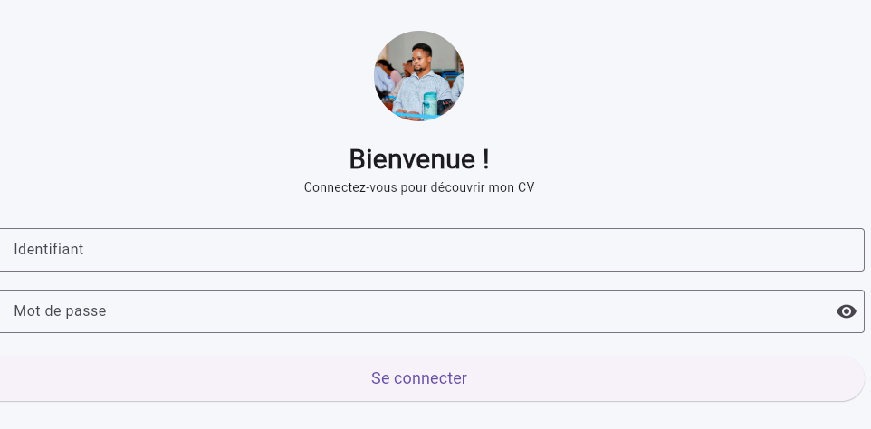
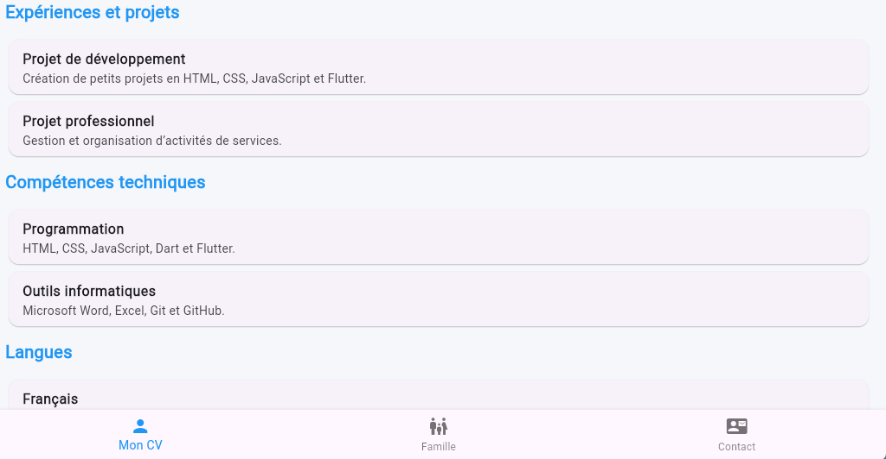
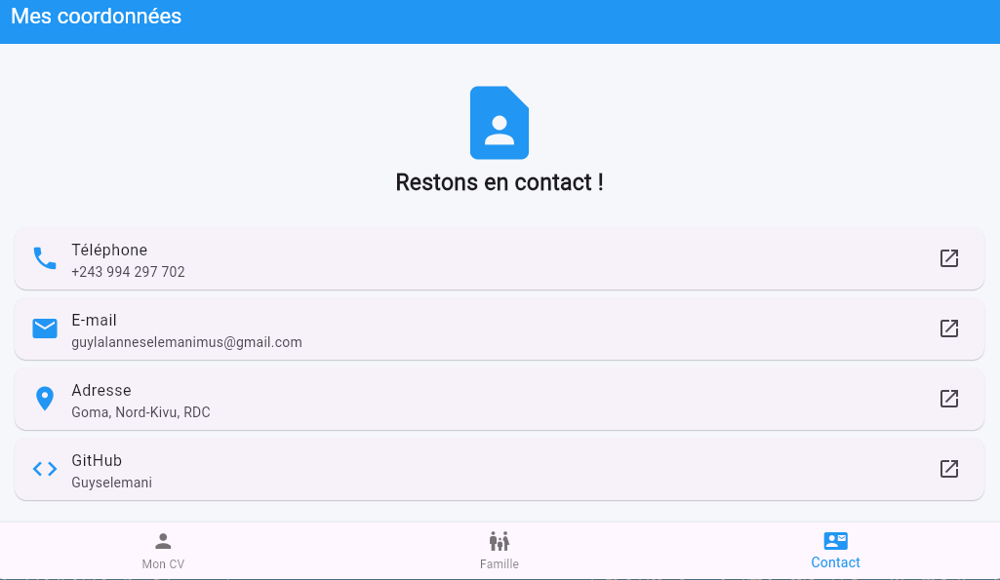

# Mon CV

## Captures d’écran

### Page de connexion



### Page du CV


### Expériences et compétences



### Page Famille


### Page Contact



## Connexion à l'API

L'application utilise l'API PHP `api-test` (XAMPP) :

- **Connexion / inscription** : `POST /accounts/login` et `POST /accounts/register` (email + mot de passe).
- **Page Famille** : liste, ajout, modification et suppression des membres via `/famille-membres`, avec photo facultative (jpg, png, gif, webp, 2 Mo max).

Adresse utilisée par défaut :

| Appareil | URL de base |
| --- | --- |
| Émulateur Android | `http://10.0.2.2/api-test/public` |
| Web, Windows, macOS, Linux, simulateur iOS | `http://localhost/api-test/public` |

Sur un vrai téléphone (même Wi-Fi que le PC), indiquer l'adresse IP du PC :

```bash
flutter run --dart-define=API_BASE_URL=http://192.168.1.10/api-test/public
```

Avant de lancer l'app : démarrer Apache et MySQL dans XAMPP et importer `api.sql`.
Pour la version web (`flutter run -d chrome`), l'API doit envoyer les en-têtes CORS
(`Access-Control-Allow-Origin`, etc.), sinon le navigateur bloque les requêtes.
